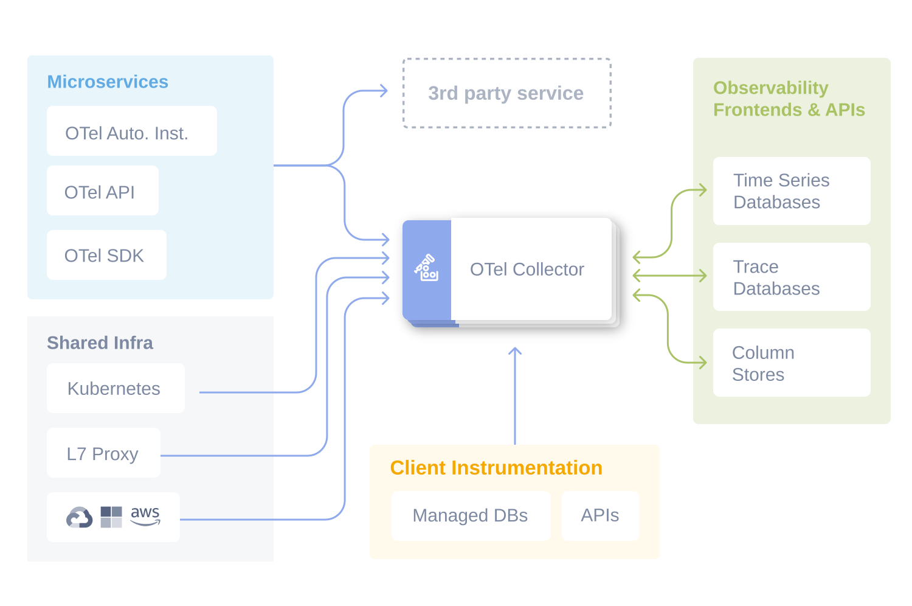

---

marp: true
theme: default
description: "Presentation generated from repository contents"
const { comments } = marpit.render(`
paginate: true

---

<!-- backgroundImage: "linear-gradient(to bottom, #222222ff, #000000ff)" -->
<!-- backgroundColor: black  -->
<!-- color: white -->
<!-- _class: lead -->

# Presentation as code
 
Using Markdown to build a presentation

---

## Repository at a glance

- Root: `index.html`, `README.md`, `LICENSE`
- Docs: `Knowledge/` (collection of short topic notes)
- Examples: `Knowledge/Examples/` (Swift & YAML learning files)

---

## Key files (root)

- `index.html` — project site entry
- `README.md` — repository README
- `LICENSE` — project license

---

## `Knowledge/` folder — topics

Files included (high level):

- `Azure4tier.md`, `AzureArc.md`, `AzureMonitor.md`, `AzureSplunkCompare.md`
- `clihelp.md`, `docker.md`, `Githelp.md`, `vscodehelp.md`, `yaml.md`
- `python.md`, `vectorsearch.md`, `mkdocsHelp.md`, `Markdownhelp.md`

<!-- Notes:
This folder holds short how-tos and reference notes useful for quick lookup. -->

---

## `Knowledge/Examples/`

- `Hello.swift` — minimal Swift example
- `quadratic.swift` — quadratic formula example
- `grok_learning_yaml/`:
  - `jon.yml` — sample YAML
  - `loop_yaml.py`, `read_yaml.py`, `test_yaml.py` — Python examples that read/process YAML

---

## Example highlights

- Swift examples show simple language usage and small algorithms.
- YAML examples include parsing/testing scripts — useful for learning config parsing.

---

## How this slide deck was created

- The deck is plain Markdown using Marp for VS Code.
- File: `slides.md` (open in VS Code and use the Marp extension to preview/export)

---

## Preview in VS Code (Marp extension)

1. Install the "Marp for VS Code" extension in VS Code.
2. Open `slides.md`.
3. Use the Marp preview (toggle preview) to view slides live.

<!--Notes:
Marp preview supports themes and presenter mode.-->

---

## Exporting (quick options)

- In VS Code Marp extension: use the command palette -> "Marp: Export" -> choose HTML / PDF / PPTX.
- Or install `@marp-team/marp-cli` and run locally (optional).

---

## Next steps & suggestions

[ ] Add images/screenshots for richer slides.
[ ] Add per-topic slides that summarize each `Knowledge/*.md` file.
[ ] Export PDF for sharing.

---

## Where to find files

- Slides: `slides.md`
- HTML export (if generated): `slides.html`
- Marp usage guide: `MARP_README.md`

---

# Thank you

_Contact: repository owner — check `README.md` for details_